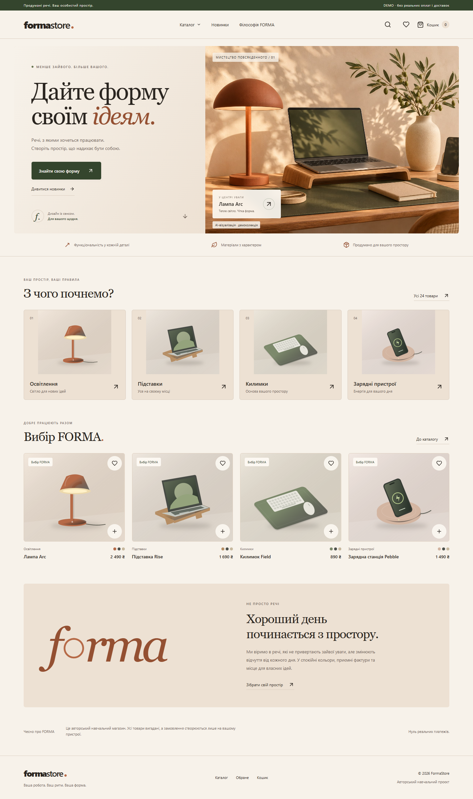

# FormaStore — Warm Editorial

A React/TypeScript demo store for fictional desk accessories with a warm editorial design. Ukrainian interface, 24 products, local cart and favorites, and a demonstration checkout. **No real orders, payments, delivery, accounts, or contact submission.**



## Run on Windows

Install Node.js 22.12+ or 24, open PowerShell in the project folder, then run:

```powershell
npm.cmd ci
npm.cmd run dev -- --port 5173 --strictPort
```

Visit **http://127.0.0.1:5173**. Alternatively, double-click `START.cmd` and keep its terminal open. Runtime binaries and dependencies are not included in the repository.

For a local workspace that already has a portable Node runtime in `.tools`, use:

```powershell
$formaNode = Get-ChildItem .tools -Directory -Filter 'node-*-win-x64' | Select-Object -First 1
$env:PATH = "$($formaNode.FullName);$env:PATH"
npm.cmd run dev -- --port 5173 --strictPort
```

## Features and routes

- `/`: editorial hero, four real catalog categories, curated product selection and store philosophy.
- `/catalog`: case-insensitive name/category/SKU search, category and inclusive price bounds, color and material filters, sorting by price/name and an explicitly tagged new collection. Filters combine, persist in the URL and appear as removable chips. Counts come from the actual dataset.
- `/products/:slug`: two SVG gallery views, modal zoom, three demo colors, quantity selection, stock limits, related products and favorites.
- `/favorites`: synchronized favorites, persisted across reloads.
- `/cart`: quantity changes, variant-specific lines, deletion, current totals and demo disclosure. A shared stock limit applies across all colors of each model.
- `/checkout`: fictional name, demo contact channel and fictional city; no phone/email/card fields. Validation updates after corrections. Demo delivery costs 0 or 90 UAH, explicitly labeled. Returning to the cart preserves its contents.
- `/receipt`: a local `FORMA-DEMO-…` receipt with line items, selected colors, quantities, delivery and totals. Successful confirmation clears the cart. JSON export omits form data.
- Missing products/routes, empty lists, unavailable stock, broken or blocked localStorage, and a failed hero image have usable fallback states.

Native dialogs support Escape, focus containment and focus restoration. Hover effects, real image-loading feedback, visible keyboard focus and reduced-motion support share the same Warm Editorial system. **There is no theme switcher.**

## Validation

```powershell
npm.cmd test
npm.cmd run lint
npm.cmd run build
npm.cmd run test:e2e
```

Playwright uses installed Microsoft Edge (`channel: msedge`), launches Vite at port 5173 or reuses an existing server. No separate browser download is required in this workspace. The full suite contains 18 browser scenarios; screenshots cover home, catalog, product, favorites, populated cart, populated checkout and receipt at 390, 768 and 1440 px.

See [QA_REPORT.md](QA_REPORT.md) for actual results, coverage and limits. [Screenshot gallery](docs/screenshots/warm-editorial/README.md).

## Ten-minute walkthrough

1. Open `/catalog`, search `FORMA-ARC`, then remove the search chip.
2. Select lighting, price 2400–3200, sand, metal and descending price: Orbit, Halo, Arc should remain. Reset all filters.
3. Favorite Arc, open it, select sand, view details, open/close zoom and choose quantity 2.
4. Add to cart: 4,980 UAH. Reload; cart and favorite remain. Increase/decrease quantity and verify totals.
5. Open checkout. Submit empty fields to see errors, then use `Олена Приклад`, demo chat and `Місто Ідей`. Select demo courier and consent: 5,070 UAH for two Arc lamps.
6. Confirm: a DEMO receipt appears, cart becomes empty, and nothing is sent or charged. Download its JSON if you want to retain it.
7. Repeat using browser widths 390, 768 and 1440; on smaller screens use the filter drawer.

## Design and assets

Cream `#F7F2EA`, sand `#D9B99B`, terracotta `#B66A47`, olive `#34452D`, graphite `#29241F`. Georgia headings and Segoe UI/Arial interface text use system fonts; no remote font dependencies.

The hero is an original AI-generated concept image, locally optimized to a 281 KB JPEG and visibly labeled. Product images are original local SVG demo illustrations with functioning variant colors, not manufacturer photos. Details, prompt and provenance: [ASSET_SOURCES.md](ASSET_SOURCES.md). Tokens and responsive rules: [DESIGN_SYSTEM.md](DESIGN_SYSTEM.md).

## Structure

| File | Role |
| --- | --- |
| `src/data.ts` | Typed fictional catalog |
| `src/domain.ts` | Filters, cart normalization, stock, totals, validation |
| `src/store.tsx` | Shared cart/favorites and localStorage |
| `src/Catalog.tsx` | URL filters, chips and mobile drawer |
| `src/Modal.tsx` | Native accessible modal |
| `src/HeroImage.tsx` | Hero loading and failure states |
| `src/Illustration.tsx` | Original procedural SVG product art |
| `src/App.tsx` | Shared cards, layout, product/cart/checkout/receipt routes |
| `src/base.css`, `src/App.module.css` | Warm Editorial tokens and responsive styles |
| `tests/`, `src/domain.test.ts` | Browser and unit verification |

## Static hosting

```powershell
npm.cmd run build
npm.cmd run preview
```

Publish the generated `dist/` directory to a static host supporting SPA rewrites. `public/_redirects` is copied to `dist/_redirects` and supplies the `/* /index.html 200` fallback for Netlify-compatible hosts. For other hosts configure unknown routes to serve `index.html`. Current assets and BrowserRouter assume a root-domain deployment. GitHub Pages subdirectory hosting needs a base path and routing fallback adjustment before publication.

Repository hosting and website deployment are separate: a source upload does not deploy the store. `.gitignore` excludes dependency/build caches, runtime tools, test reports and `.env` files. No API keys or environment variables are needed.

## Demo limits

All products, specifications and stock are fictional. Stock is not decremented globally after a demo order. Cart/favorites live under `forma-cart-v1` / `forma-favorites-v1` in the current browser and origin; there is no cross-tab or cross-device synchronization. Form data is never persisted or sent. The receipt exists in memory until reload; export JSON before leaving if needed.

After the app has loaded, catalog/cart actions work without the network; a first offline visit or offline full reload is not guaranteed (there is no service worker). Browser QA was performed with Edge on Windows, not physical phones, Safari or Firefox. System font appearance can vary by OS.
