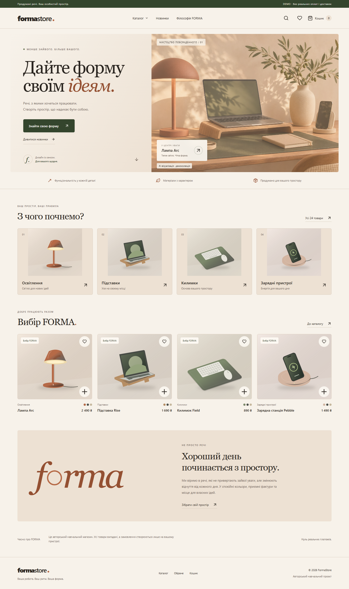
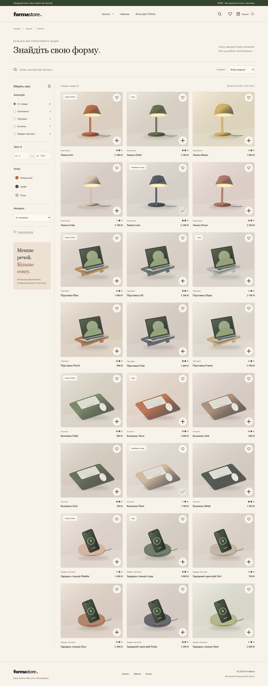
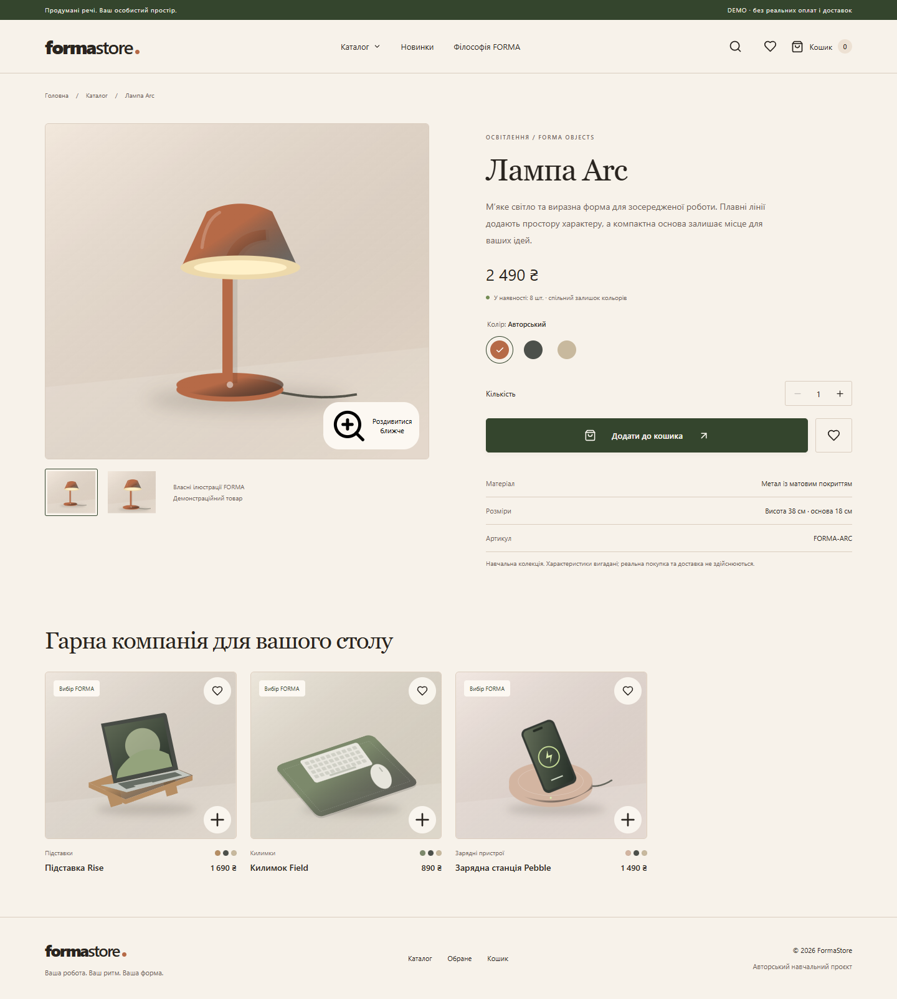

# FormaStore — простір для ваших ідей

**Тип:** самостоятельный учебный e-commerce проект. **Роль:** разработка интерфейса, оригинальный дизайн, SVG-графика, тестирование и локальная подготовка. **Бюджет:** 0 грн. **Проверено:** 03.11.2026.

## Задача и аудитория

Показать законченный путь посетителя от выбора аксессуара для рабочего места до подтверждения демонстрационного заказа. Аудитория сценария — люди, собирающие удобный домашний рабочий стол. Аудитория кейса — потенциальные заказчики разработки интерфейсов и проверяющие портфолио.

## Ограничения

Только локальная работа, без серверов, внешних API, оплаты и реальных персональных данных. Все товары и характеристики вымышлены. Оригинальные иллюстрации созданы из SVG-примитивов; чужие магазины, отзывы и скидки не копировались. Это не подтверждённый коммерческий заказ.

## Решение

Украинский интерфейс с тёплым светлым фоном, оливковыми и терракотовыми акцентами, крупной типографикой и единым семейством векторных иллюстраций. Каталог содержит 24 товара в четырёх категориях. Поиск с задержкой, совмещаемые фильтры и сортировка помогают выбрать товар; отдельные URL, галерея и цвета раскрывают детали.

Корзина учитывает общий остаток модели независимо от выбранного цвета. Избранное и корзина восстанавливаются из localStorage с проверкой данных. Демооформление использует только вымышленные примеры. Квитанция формируется в памяти браузера, не содержит имени и скачивается в JSON. В интерфейсе явно указано: «Демо — замовлення не надсилається».

## Проверка и результат

Production-сборка и ESLint пройдены. **16 unit-тестов** проверяют фильтрацию, сортировку, суммы, лимиты и валидацию. **10 браузерных тестов** в Microsoft Edge проверяют покупательский сценарий, ошибки, перезагрузку, обране, скачивание квитанции и responsive-поведение. Проверены 360, 768, 1440 px; внешних HTTP(S)-запросов в демосценарии не обнаружено. Результаты и ограничения подробно отражены в [QA.md](QA.md).

Результат — локальный работающий учебный магазин, пригодный для демонстрации разработки интерфейса. Метрики конверсии, коммерческие продажи и отзывы клиентов не заявляются. Safari, Firefox, реальные мобильные устройства и полный аудит доступности не проверены.

## Три скриншота интерфейса

Дополнительно: [главная 360 px](docs/screenshots/04-home-360.png), [каталог 768 px](docs/screenshots/05-catalog-768.png).

## Материалы для отдельного портфолио

**Название:** FormaStore — демонстрационный интернет-магазин.

**Краткое описание на украинском:** «Авторський магазин аксесуарів для робочого простору: 24 товари, пошук і фільтри, обране, кошик із контролем залишків та локальна демоквитанція. React, TypeScript, Vite. 16 unit-тестів і 10 браузерних сценаріїв. Навчальний проєкт без реальних платежів».

**Теги:** React, TypeScript, Vite, E-commerce, CSS Modules, SVG, Vitest, Playwright.

**Обложка:** `docs/screenshots/01-home-1440.png`.

**Ссылки для локального показа после запуска:**

- Главная: http://127.0.0.1:5173/
- Каталог: http://127.0.0.1:5173/catalog
- Товар: http://127.0.0.1:5173/products/arc

**Публичная демоссылка и репозиторий:** отсутствуют; публикация не выполнялась. Localhost нельзя вставлять в публичное портфолио как доступный посетителям сайт. До отдельного решения владельца можно использовать описание и скриншоты, а URL оставить незаполненным.

**Статус отдельного портфолио:** не изменён. `profile.js` не читался и не редактировался. Установка `status: complete` требует решения владельца, даже при пройденных локальных критических сценариях.
